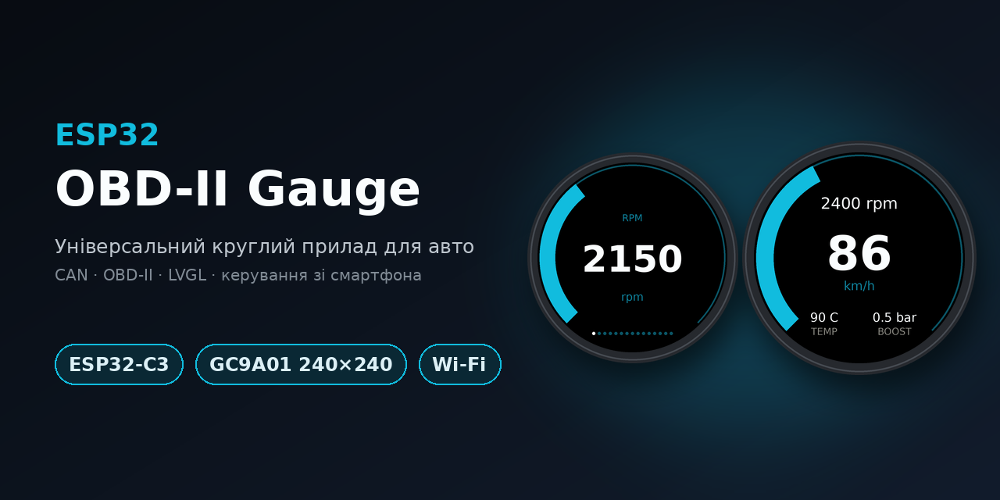
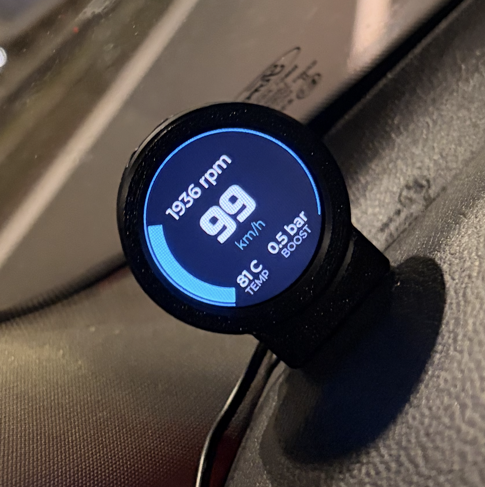
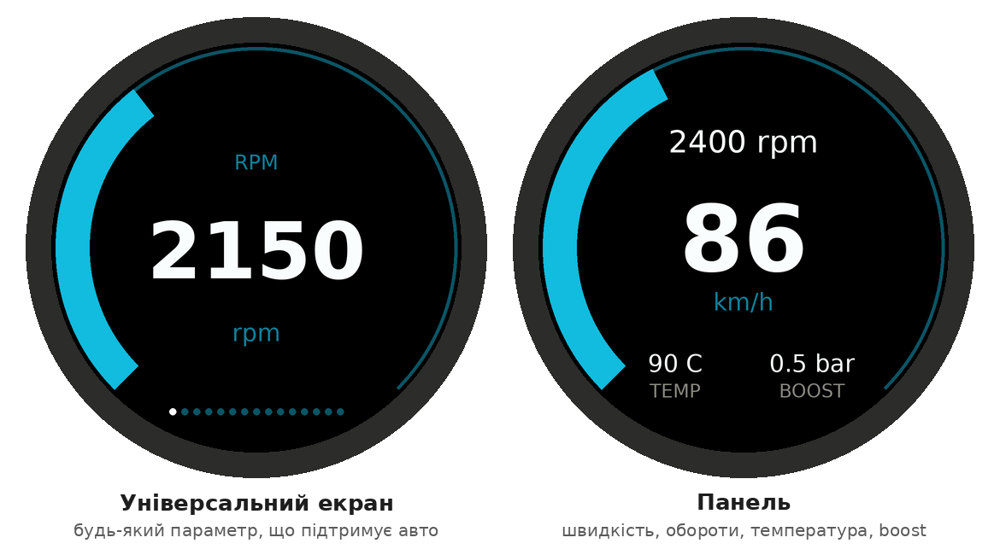
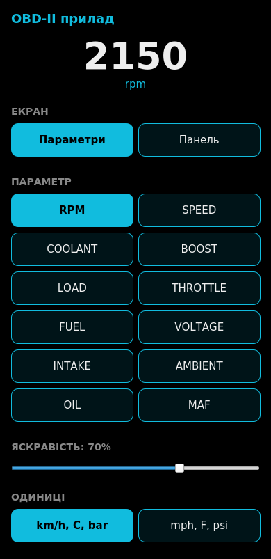
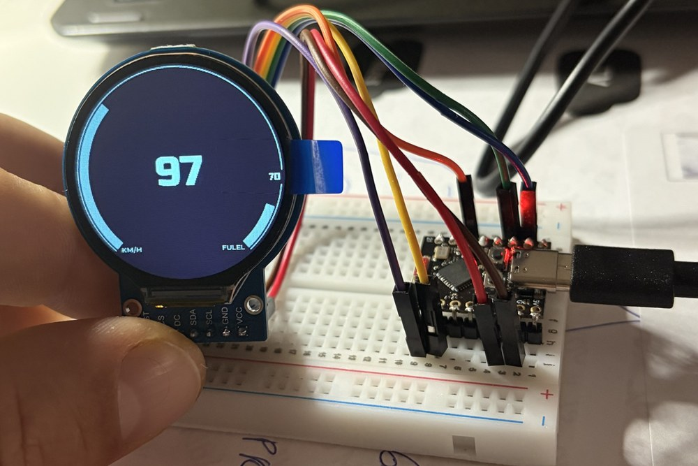
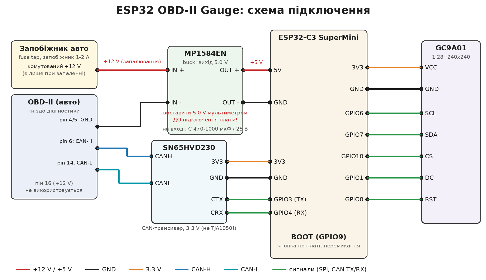

# ESP32 OBD-II Gauge

A universal round automotive gauge based on the **ESP32-C3** and a **GC9A01 240×240** round display.
It reads OBD-II data via the CAN bus, displays it on the screen, and can be controlled via a physical button or **via Wi-Fi from a smartphone** (no app required, using a standard web browser).



> Tested on a Ford Focus 1.6 diesel (2012). It works on other cars as long as they support standard OBD-II queries (Mode 01) over CAN. This is a DIY project: use at your own risk (see [Safety](#safety)).

## Features

- **Auto-scan vehicle:** The gauge tests 500 and 250 kbps CAN speeds, queries the car for supported standard parameters (PIDs), and displays only the supported ones.
- **Universal screen:** A single arc, numerical value, name, and units for any parameter (up to 15 parameters, see the [Parameters](#parameters) table).
- **"Dashboard" screen:** Speed in the center, RPM arc, coolant temperature, and boost.
- **Control via onboard button** and **smartphone**: Built-in Wi-Fi access point and a web page in your browser.
- Units: km/h ↔ mph, °C ↔ °F, bar ↔ psi. Smooth brightness adjustment from 5% to 100%.
- Saves units, the last viewed parameter, screen mode, and brightness.
- Startup arc animation, color-coded warnings (RPM, coolant temperature, boost, oil).
- **Overheat protection:** Wi-Fi turns off if the chip temperature exceeds 85 °C and re-enables after cooling down to 75 °C.
- **Sleep mode:** If the car is not found for 15 minutes, the board enters deep sleep and wakes up upon CAN bus activity.
- **Read-only:** The gauge sends only standard Mode 01 queries and never writes anything to the car.
- **DEMO mode** for testing and debugging without a car.

## What It Looks Like

Schematic representation of two screens (arc color changes near the scale limit):



Smartphone control page (captured from the actual firmware HTML with test data):



First prototype on a breadboard (showing an older interface version):



## Bill of Materials

| Component | Note |
|---|---|
| ESP32-C3 SuperMini | An option for ESP32 WROOM-32 DevKit is also available, see [docs/hardware.md](docs/hardware.md) |
| GC9A01 1.28" 240×240 SPI Display, 7 pins | Non-touch version: VCC, GND, SCL, SDA, DC, CS, RST |
| **SN65HVD230** CAN Transceiver (3.3V) | **Do not** use TJA1050 or MCP2551: they are 5V-only |
| OBD-II connector with wires | Pins 4/5, 6, 14, 16 required |
| MP1584EN step-down buck converter | **Set to 5.0V using a multimeter** before connecting the board |
| 1A Fuse | For the +12V line |
| Dupont wires, breadboard | For assembly and testing |

## Wiring Diagram



| ESP32-C3 SuperMini | Destination |
|---|---|
| GPIO6 | Display SCL |
| GPIO7 | Display SDA |
| GPIO10 | Display CS |
| GPIO1 | Display DC |
| GPIO0 | Display RST |
| GPIO3 | CAN Transceiver CTX |
| GPIO4 | CAN Transceiver CRX |
| GPIO9 (BOOT) | Onboard button |
| 3V3, GND | Display and transceiver power |
| 5V, GND | Buck converter output |

CANH → OBD-II pin 6, CANL → pin 14, GND → pin 4 or 5. **Power (recommended):** Switched +12V from a fuse tap → buck converter 5.0V; do not connect OBD-II pin 16 so the gauge draws zero power when the ignition is off.
For details, see [docs/hardware.md](docs/hardware.md).

## Quick Start

1. Assemble the device according to the wiring diagram ([docs/hardware.md](docs/hardware.md)).
2. Set up Arduino IDE and libraries ([docs/software.md](docs/software.md)): ESP32 board support, **LVGL 8.3.11**, and GFX Library for Arduino. Copy [`firmware/lv_conf.h`](firmware/lv_conf.h) to `Documents/Arduino/libraries/` (next to the `lvgl` folder).
3. Open `firmware/speedo_universalwifi/speedo_universalwifi.ino`. Board settings: **ESP32C3 Dev Module**, **USB CDC On Boot: Enabled**, **Partition Scheme: Huge APP (3MB No OTA/1MB SPIFFS)**.
4. Change the Wi-Fi password `WIFI_PASS` (minimum 8 characters).
5. First, set `#define DEMO 1`, flash the device, and verify the display works. Then switch back to `DEMO 0`.
6. **Disconnect the buck converter** and flash via USB. Then connect it to the car.

> Interface files exported from SquareLine (`ui*.c`, `ui*.h`, fonts) are required for building and are located next to the sketch in `firmware/speedo_universalwifi/`. Instructions on how to create or modify them can be found in [docs/software.md](docs/software.md).

## Controls

Onboard BOOT button (GPIO9):

| Action | Result |
|---|---|
| Short press | Next page: parameters, then "Dashboard", then back to the first parameter |
| Hold for 0.7–2 s | Switch units: km/h ↔ mph, °C ↔ °F, bar ↔ psi |
| Hold for 2–4 s | Brightness: 100 → 60 → 30 → 14 % |
| Hold for 4+ s | Toggle Wi-Fi on/off (triggers while the button is still held down) |

> Do not hold the BOOT button while plugging in power: GPIO9 on the ESP32-C3 enters bootloader mode.

**Wi-Fi.** By default, the access point starts automatically (`WIFI_AUTOSTART`). Connect to the `Gauge` network (password `WIFI_PASS`) and open **`http://192.168.4.1`** in your browser (make sure to use `http://`). On the page: screen and parameter selection, brightness slider, units. Wi-Fi turns off automatically after 3 minutes of inactivity (`WIFI_IDLE_MS`, 0 = never turn off).

## Parameters

Only parameters supported by your car (Mode 01 PIDs) are displayed.

| Name | PID | Note |
|---|---|---|
| RPM | 0x0C | Engine speed |
| SPEED | 0x0D | Vehicle speed |
| COOLANT | 0x05 | Coolant temperature |
| BOOST | 0x0B (+0x33) | Boost pressure = MAP − barometric pressure |
| LOAD | 0x04 | Engine load |
| THROTTLE | 0x11 | Throttle position |
| FUEL | 0x2F | Fuel level (smoothed) |
| VOLTAGE | 0x42 | System voltage |
| INTAKE | 0x0F | Intake air temperature |
| AMBIENT | 0x46 | Ambient temperature |
| OIL | 0x5C | Oil temperature (not supported on all cars) |
| MAF | 0x10 | Mass air flow |
| FUEL RATE | 0x5E | Fuel consumption rate |
| CAT B1S1 / B1S2 | 0x3C / 0x3E | Catalyst temperature |

To add a custom parameter: add a single line to the `PARAMS` table and (if necessary) a formula in `decodePid()`.
The list of PIDs supported by your car is printed by the gauge to the Serial Monitor (`Supported PIDs: ...`). For independent testing without a screen, use the utility [`tools/pidscan`](tools/pidscan/pidscan.ino).

## Code Configuration

Flags at the top of `speedo_universalwifi.ino`:

| Parameter | Description |
|---|---|
| `DEMO` | 1 = dummy values, no car needed |
| `DEBUG_SERIAL` | 1 = prints values, response frequency, and response time to Serial once per second |
| `BOOT_ANIM`, `BOOT_UP_MS`, `BOOT_DOWN_MS` | Startup arc animation settings |
| `ENABLE_WIFI` | 0 = Wi-Fi completely disabled in code |
| `WIFI_AUTOSTART` | 1 = Wi-Fi turns on at startup |
| `WIFI_SSID`, `WIFI_PASS` | Network name and password (change the password!) |
| `WIFI_IDLE_MS` | Auto-turn off Wi-Fi after inactivity, 0 = never |
| `WIFI_TX_POWER` | Transmitter power (lower = more stable on SuperMini) |
| `WIFI_TEMP_OFF`, `WIFI_TEMP_ON` | Overheat protection: Wi-Fi turns off at crystal temp ≥ OFF and re-enables ≤ ON (0 = protection disabled) |
| `SLEEP_AFTER_MS` | Sleep after this many ms without finding a car (0 = do not sleep) |
| `ENABLE_DASH` | 1 = "Dashboard" screen (requires setup in SquareLine project) |
| `RPM_MAX` | End of the RPM scale (diesel ≈ 5000, gasoline ≈ 7000) |

## How It Works

```mermaid
flowchart LR
  CAR["Car (OBD-II)"] -- CAN --> TR["SN65HVD230"]
  TR --> POLL
  subgraph MCU["ESP32-C3"]
    SCAN["Autoscan: bus speed + PIDs"] --> TBL["PARAMS table"]
    POLL["PID polling (Mode 01)"] --> UI["LVGL UI"]
    BTN["BOOT button"] --> UI
    WEB["Wi-Fi Web Server (separate task)"] -- "commands" --> UI
  end
  UI --> LCD["GC9A01 240x240"]
  PHONE["Smartphone"] -- Wi-Fi --> WEB
