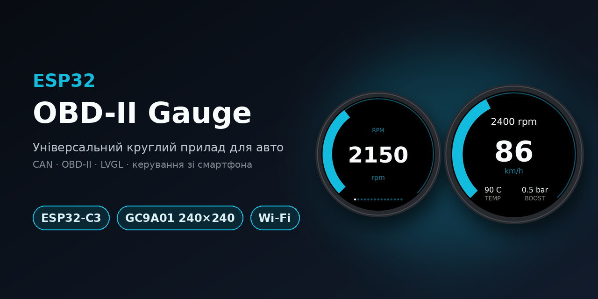
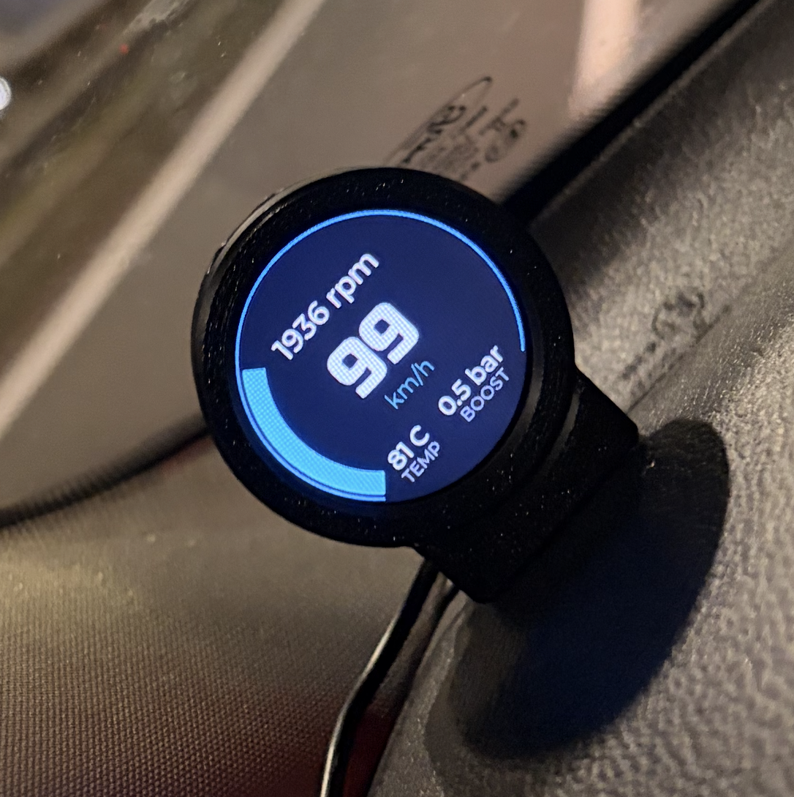
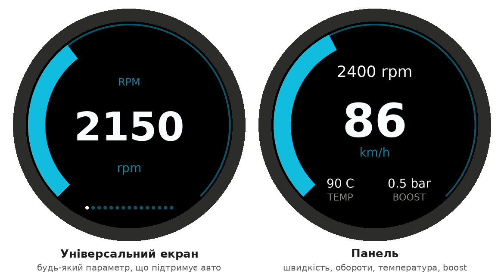
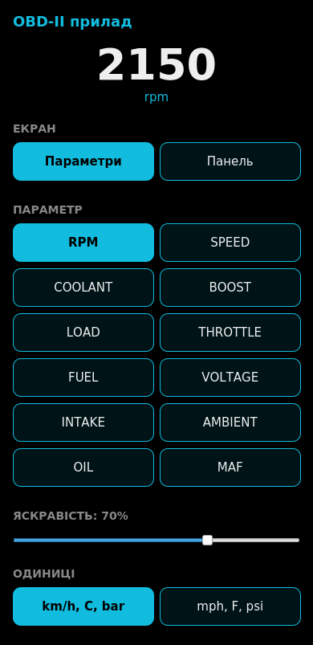
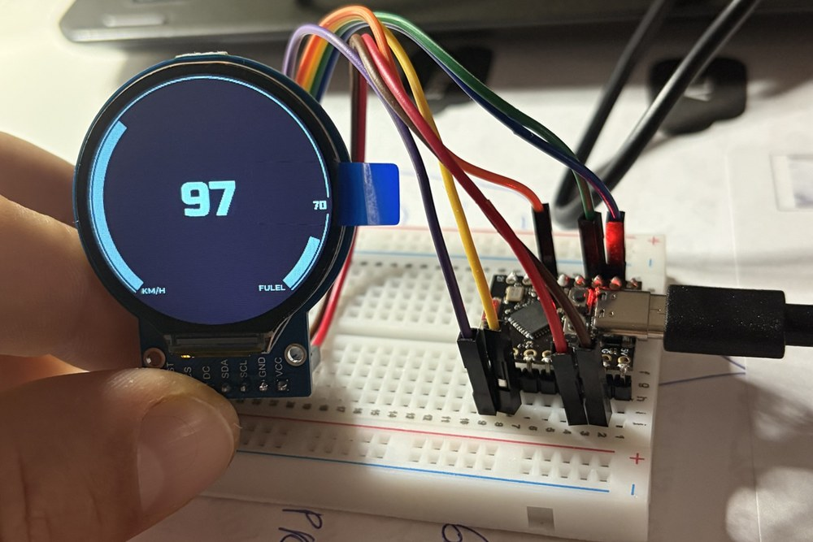
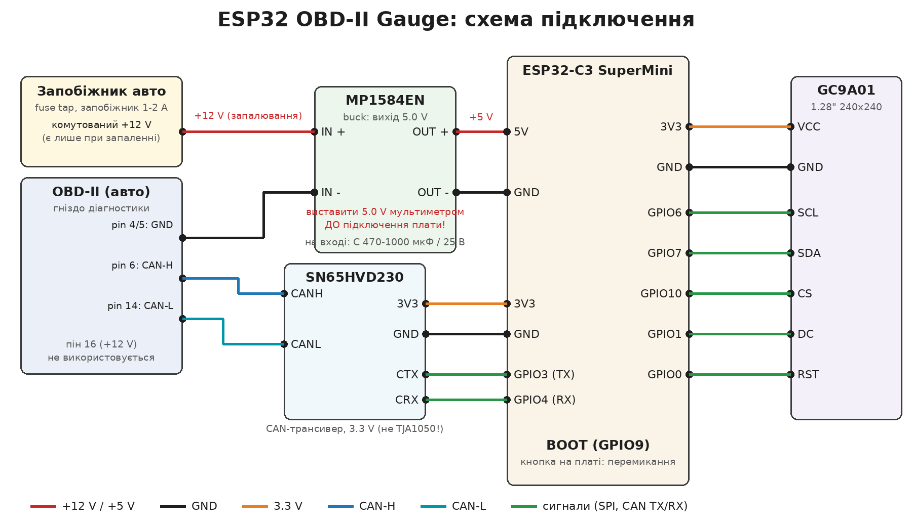
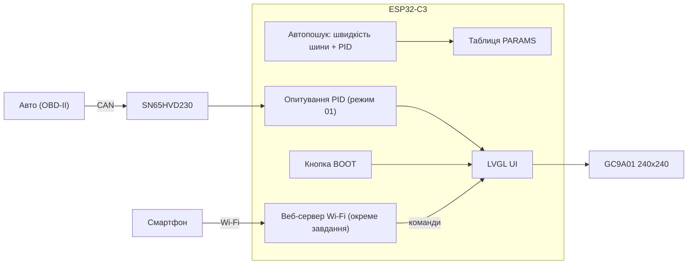

[README.md](https://github.com/user-attachments/files/33978812/README.md)


# ESP32 OBD-II Gauge

Універсальний круглий прилад для авто на **ESP32-C3** і круглому дисплеї **GC9A01 240×240**.
Читає дані з OBD-II по CAN-шині, показує їх на екрані й керується кнопкою або **зі смартфона по Wi-Fi** (без застосунку, через браузер).



> Перевірено на Ford Focus 1.6 diesel (2012). На інших авто працює, якщо вони підтримують стандартні запити OBD-II (режим 01) по CAN. Проєкт самодіяльний: використовуєте на власний ризик (див. [Безпека](#безпека)).

## Можливості

- **Автопошук авто.** Прилад пробує CAN 500 і 250 кбіт/с, питає в авто, які стандартні параметри (PID) воно підтримує, і показує лише їх.
- **Універсальний екран:** одна дуга, число, назва й одиниці для будь-якого параметра (до 15 параметрів, див. [таблицю](#параметри)).
- **Екран «Панель»:** швидкість у центрі, обороти дугою, температура ОР і boost.
- **Керування кнопкою** на платі та **зі смартфона**: точка доступу Wi-Fi і сторінка в браузері.
- Одиниці виміру: км/год ↔ mph, °C ↔ °F, бар ↔ psi. Плавна яскравість 5–100 %.
- Запам'ятовує одиниці, останній параметр, вигляд екрана й яскравість.
- Стартова анімація дуги, кольорові попередження (обороти, температура ОР, boost, олива).
- **Захист від перегріву:** Wi-Fi вимикається, якщо чип нагрівається вище 85 °C, і знову дозволяється після охолодження до 75 °C.
- **Сон:** якщо авто не знайдено 15 хвилин, плата засинає й прокидається від активності на CAN-шині.
- **Лише читання:** прилад надсилає тільки стандартні запити режиму 01 і нічого не записує в авто.
- Режим **DEMO** для налагодження без авто.

## Як виглядає

Схематичне зображення двох екранів (колір дуги змінюється біля межі шкали):



Сторінка керування зі смартфона (знімок зроблено з реального HTML прошивки з тестовими даними):



Перший прототип на макетній платі (на фото стара версія інтерфейсу):



## Що потрібно

| Компонент | Примітка |
|---|---|
| ESP32-C3 SuperMini | є варіант для ESP32 WROOM-32 DevKit, див. [docs/hardware.md](docs/hardware.md) |
| Дисплей GC9A01 1.28" 240×240, SPI, 7 пінів | версія без тачскріна: VCC, GND, SCL, SDA, DC, CS, RST |
| CAN-трансивер **SN65HVD230** (3.3 V) | **не** TJA1050 і не MCP2551: вони на 5 V |
| Штекер OBD-II з виводами | потрібні піни 4/5, 6, 14, 16 |
| Понижувальний перетворювач MP1584EN | **виставити 5.0 V мультиметром** до підключення плати |
| Запобіжник 1 А | у лінію +12 V |
| Дроти Dupont, макетна плата | для збирання й тестів |

## Схема підключення



| ESP32-C3 SuperMini | Куди |
|---|---|
| GPIO6 | дисплей SCL |
| GPIO7 | дисплей SDA |
| GPIO10 | дисплей CS |
| GPIO1 | дисплей DC |
| GPIO0 | дисплей RST |
| GPIO3 | CAN-трансивер CTX |
| GPIO4 | CAN-трансивер CRX |
| GPIO9 (BOOT) | кнопка на платі |
| 3V3, GND | живлення дисплея й трансивера |
| 5V, GND | вихід buck-конвертера |

CANH → пін 6 розʼєму OBD-II, CANL → пін 14, GND → пін 4 або 5. **Живлення (рекомендовано):** комутований +12 V від перехідника для запобіжника (fuse tap) → buck 5.0 V; пін 16 OBD-II не підключати, тоді з вимкненим запалюванням прилад нічого не споживає.
Докладно: [docs/hardware.md](docs/hardware.md).

## Швидкий старт

1. Зберіть пристрій за схемою ([docs/hardware.md](docs/hardware.md)).
2. Налаштуйте Arduino IDE й бібліотеки ([docs/software.md](docs/software.md)): плата ESP32, **LVGL 8.3.11**, GFX Library for Arduino. Скопіюйте [`firmware/lv_conf.h`](firmware/lv_conf.h) у `Документи/Arduino/libraries/` (поруч із папкою `lvgl`).
3. Відкрийте `firmware/speedo_universal/speedo_universal.ino`. Налаштування плати: **ESP32C3 Dev Module**, **USB CDC On Boot: Enabled**, **Partition Scheme: Huge APP (3MB No OTA/1MB SPIFFS)**.
4. Змініть пароль Wi-Fi `WIFI_PASS` (мінімум 8 символів).
5. Спершу поставте `#define DEMO 1`, прошийте й переконайтеся, що екран працює. Потім `DEMO 0`.
6. **Відключіть buck-конвертер** і прошийте через USB. Потім підключіть до авто.

> Для збирання потрібні файли інтерфейсу, експортовані зі SquareLine (`ui*.c`, `ui*.h`, шрифти): вони лежать поруч зі скетчем у `firmware/speedo_universal/`. Як їх створити або змінити, описано в [docs/software.md](docs/software.md).

## Керування

Кнопка BOOT на платі (GPIO9):

| Дія | Що відбувається |
|---|---|
| Коротке натискання | наступна сторінка: параметри, потім «Панель», потім знову перший параметр |
| Утримання 0.7–2 с | км/год ↔ mph, °C ↔ °F, бар ↔ psi |
| Утримання 2–4 с | яскравість: 100 → 60 → 30 → 14 % |
| Утримання 4 с і більше | Wi-Fi вмикається або вимикається (спрацьовує, поки кнопка ще тримається) |

> Не тримайте BOOT при подачі живлення: GPIO9 на ESP32-C3 вмикає режим завантаження.

**Wi-Fi.** За замовчуванням точка доступу вмикається при запуску (`WIFI_AUTOSTART`). Підключіться до мережі `Gauge` (пароль `WIFI_PASS`) і відкрийте у браузері **`http://192.168.4.1`** (саме `http://`). На сторінці: вибір екрана й параметра, повзунок яскравості, одиниці. Wi-Fi вимикається сам після 10 хвилин без дій (`WIFI_IDLE_MS`, 0 = не вимикати).

## Параметри

Показуються лише ті, які підтримує авто (PID режиму 01).

| Назва | PID | Примітка |
|---|---|---|
| RPM | 0x0C | обороти |
| SPEED | 0x0D | швидкість |
| COOLANT | 0x05 | температура ОР |
| BOOST | 0x0B (+0x33) | надлишковий тиск = MAP − атмосферний |
| LOAD | 0x04 | навантаження двигуна |
| THROTTLE | 0x11 | положення дроселя |
| FUEL | 0x2F | рівень палива (згладжений) |
| VOLTAGE | 0x42 | напруга бортмережі |
| INTAKE | 0x0F | температура впускного повітря |
| AMBIENT | 0x46 | температура довкілля |
| OIL | 0x5C | температура оливи (є не на всіх авто) |
| MAF | 0x10 | витрата повітря |
| FUEL RATE | 0x5E | витрата палива |
| CAT B1S1 / B1S2 | 0x3C / 0x3E | температура каталізатора |

Додати свій параметр: один рядок у таблиці `PARAMS` і (за потреби) формула в `decodePid()`.
Список PID, які підтримує саме ваше авто, прилад виводить у Serial Monitor (`Supported PIDs: ...`). Для окремої перевірки без екрана є утиліта [`tools/pidscan`](tools/pidscan/pidscan.ino).

## Налаштування в коді

Прапорці вгорі `speedo_universal.ino`:

| Параметр | Що робить |
|---|---|
| `DEMO` | 1 = вигадані значення, без авто |
| `DEBUG_SERIAL` | 1 = раз на секунду друкує значення, частоту відповідей і час відповіді авто |
| `BOOT_ANIM`, `BOOT_UP_MS`, `BOOT_DOWN_MS` | стартова анімація дуги |
| `ENABLE_WIFI` | 0 = Wi-Fi повністю вимкнено в коді |
| `WIFI_AUTOSTART` | 1 = Wi-Fi вмикається при запуску |
| `WIFI_SSID`, `WIFI_PASS` | назва й пароль мережі (пароль змініть!) |
| `WIFI_IDLE_MS` | автовимкнення Wi-Fi після простою, 0 = ніколи |
| `WIFI_TX_POWER` | потужність передавача (нижча = стабільніше на SuperMini) |
| `WIFI_TEMP_OFF`, `WIFI_TEMP_ON` | захист від перегріву: Wi-Fi вимикається за температури кристала ≥ OFF і дозволяється знову ≤ ON (0 = захист вимкнено) |
| `SLEEP_AFTER_MS` | сон після стількох мс без знайденого авто (0 = не засинати) |
| `ENABLE_DASH` | 1 = екран «Панель» (потрібен у проєкті SquareLine) |
| `RPM_MAX` | кінець шкали обертів (дизель ≈ 5000, бензин ≈ 7000) |

## Як це працює



- Опитується лише той параметр, який зараз на екрані (плюс атмосферний тиск для boost), тому оновлення швидке, а шина не перевантажується.
- Веб-сервер працює в окремому завданні FreeRTOS і лише залишає команди: LVGL і CAN обробляє головний цикл.
- Якщо авто мовчить 8 секунд (запалювання вимкнено), прилад повертається до пошуку.

## Структура репозиторію

```
esp32-obd-gauge/
├─ firmware/
│  ├─ lv_conf.h                  # конфігурація LVGL 8.3.11
│  └─ speedo_universal/          # скетч Arduino + експорт SquareLine (ui*.c/h, шрифти)
├─ tools/pidscan/                # утиліта: які PID підтримує авто
├─ assets/arc-segment-masks/     # експериментальні маски сегментів дуги (поки не використовуються)
├─ docs/                         # hardware.md, software.md, troubleshooting.md, images/
├─ LICENSE
└─ README.md
```

## Безпека

- Прилад **лише читає** дані: надсилає стандартні запити режиму 01 (широкомовний ID 0x7DF) і нічого не записує в авто.
- Живіть прилад від **комутованого +12 V** (fuse tap із запалюванням), запобіжник 1–2 А, і перевіряйте полярність. Налаштуйте buck на 5.0 V мультиметром до підключення плати.
- Пін 16 розʼєму OBD-II живиться постійно: якщо взяти живлення з нього, прилад споживатиме струм і при вимкненому запалюванні (споживання не вимірювалося, підсвітка дисплея не вимикається навіть у сні). Краще використовувати fuse tap.
- Не користуйтеся телефоном за кермом: налаштовуйте на стоянці.
- Автор не несе відповідальності за наслідки використання.

## Плани

- Читання кодів несправностей (режими 03/07/0A).
- 29-бітні CAN-адреси; старі авто з K-line (потрібен інший перехідник).
- Індикатор регенерації DPF (за температурою каталізатора або специфічними для марки даними).
- Сегментована дуга (маска-картинка в LVGL 8).
- Автояскравість за фоторезистором.
- Корпус для друку уже додано 1,28TFT ESP32.stl.(https://github.com/fixdiaglab-design/esp32-obd-gauge/blob/c8c34c43a2b24e6eb71bf33002c7cabd4d003abc/1%2C28TFT%20ESP32.stl)

## Ліцензія та подяки

Код розповсюджується за ліцензією [MIT](LICENSE).

- [LVGL](https://lvgl.io/) (MIT), [GFX Library for Arduino](https://github.com/moononournation/Arduino_GFX), драйвер TWAI від Espressif.
- Інтерфейс спроєктовано в SquareLine Studio.
- Шрифт великих цифр (`ui_font_Font2`) згенеровано зі шрифту Russo One (SIL Open Font License); дрібні написи використовують Montserrat із LVGL (SIL OFL).
